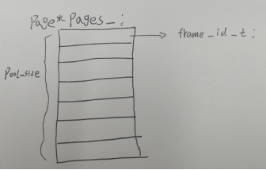
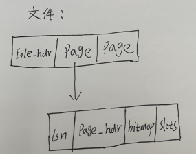

对于第一题，主要知识点就是对于底层的逻辑操作以及一些计算机基础知识的认知。

# 首先引入磁盘和内存的概念：

磁盘是数据库中数据和元数据的最终存储载体，用于临时存储计算机正在运行的程序、数据以及中间结果。磁盘具有非易失性（数据断电后仍保留）和大容量（可存储海量数据）的特点，内存速度快但容量小，易失性也比较高。

数据库的所有核心操作（如查询、插入、更新、删除）最终都需要与磁盘交互，磁盘的性能（如读写速度、吞吐量）直接影响数据库的整体效率。

数据库的数据最终存储在磁盘中，但磁盘的读写速度远低于内存（两者速度差距可达万倍甚至更高）。

如果每次操作（如查询、插入、更新）都直接与磁盘交互就会导致：

性能瓶颈：频繁的磁盘 IO 会让数据库操作变得非常缓慢。
效率低下：重复访问同一数据时，每次都从磁盘读取会重复消耗 IO 资源。
稳定性风险：磁盘的物理寿命有限，频繁读写会缩短其使用寿命，增加故障概率。

为了平衡磁盘和内存之间的关系，我们引入了一个缓冲池这种结构。

缓冲池是数据库在内存中开辟的一块专用区域，用于临时缓存从磁盘读取的数据页（数据库中数据的基本存储单位）。

**接下来我们用一个示例去解释一下缓冲池的具体作用。**

现在我们有一个图书仓库，其中里面存在10万本书，我们可以将磁盘抽象为这个概念。

如果每次借书，图书管理员都需要从这10万本书里面依次查找，那么这样的效率可能是非常低下的。

为了解决这个问题，我们再建立一个小型的图书馆，这里面只存在1万本书，每次借书都是从这1万本书里面开始查找。如果之前查找一本书的时间为10分钟，这样一算的话我们就只需要1分钟了，时间效率大大的降低了，但是可能会存在有些书籍不存在的情况，我们就需要再去仓库中寻找。但是我们就可以解决大部分人借书的问题。

那这样又有人问了，从仓库中取回来的书应该放在哪里呢？小型图书馆最多只可以放置1万本书，那么我们就需要将这1万本书拿回去一些到仓库里面去，进行替换策略。那么替换规则就是最近被借的书籍，在未来一段时间内被再次被借的概率更高。所以我们就需要去找到很久没有被借的书籍优先放回去。这样的策略算法再数据库中就叫做LRU替换策略（优先淘汰很久没有用的）。

上面的示例大致的就解释了数据库中内部操作的思路。也就是前置的知识体系，我们需要了解这些知识之后再去看或者写代码会非常有帮助。

**引入**：“页”（Page）是数据存储和管理的基本单位，是数据库与存储设备（如磁盘）交互的最小单元，也是内存与磁盘之间数据交换的核心载体。数据库将磁盘上的存储空间划分为大小固定的 “块”，每个块就称为一个页。MySQL（InnoDB 引擎）默认页大小为 16KB；
数据在磁盘文件中是按照页面（Page）形式组织的。为避免直接访问磁盘数据页面而造成高昂的I/O开销，存储子系统在内存中创建缓冲池（Buffer Pool）来缓存部分磁盘数据页面。

缓冲池维护固定数量的内存页面，每个内存页面称为“帧”（Frame），一般情况下，每一帧的大小与磁盘数据页面的大小保持一致。受制于内存容量，缓冲池只能缓存部分数据页面。

接下来就具体讲解一下每一个模板的具体实现和逻辑。


首先先可以看看数据库中用到的函数，方便大家的后续理解。

## 任务1.1 磁盘存储管理器（DiskManager类）
```
class DiskManager {
   public:
    explicit DiskManager();        // Constructor
    ~DiskManager() = default;    // Destructor
    // 读写页面
    void write_page(int fd, page_id_t page_no, const char *offset, int num_bytes);
    void read_page(int fd, page_id_t page_no, char *offset, int num_bytes);
    // 对指定文件分配页面编号
    page_id_t allocate_page(int fd);
    // 文件操作
    bool is_file(const std::string &path);
    void create_file(const std::string &path);
    int open_file(const std::string &path);
    void close_file(int fd);
    void destroy_file(const std::string &path);
};
```

**整体框架：**

通过文件句柄找到文件磁盘路径，或者通过文件磁盘路径找到文件句柄。
`std::unordered_map<std::string, int> path2fd_;  //<Page文件磁盘路径,Page fd>哈希表`
`std::unordered_map<int, std::string> fd2path_;  //<Page fd,Page文件磁盘路径>哈希表`

表示当前文件中以及分配的页面个数。
`std::atomic<page_id_t> fd2pageno_[MAX_FD]{};  // 文件中已经分配的页面个数，初始值为0`

这些接口的内部实现调用了Linux操作系统下/usr/include/unistd.h提供的read()、write()、open()、close()，unlink()等函数。

### （1）读写页面

`void write_page(int fd, page_id_t page_no, const char *offset, int num_bytes);`

`void read_page(int fd, page_id_t page_no, char *offset, int num_bytes);`

将数据写入磁盘里面，或者从磁盘中读出数据。

第一个参数fd表示文件句柄（File Handle）， 是一个用于标识和管理打开文件的抽象引用或标识符。它的核心作用是简化程序对文件的操作，充当程序与操作系统之间的 “中介”，避免直接暴露底层文件的物理信息（如磁盘地址、存储结构等）。

第二个参数page_no表示页号， 是用于唯一标识一个 “页”（Page）的整数编号，相当于页在物理存储或逻辑空间中的 “地址”。它是定位、管理和访问页的核心标识，贯穿数据存储、读写、索引等整个流程。

第三个参数offset表示数据，需要写入磁盘或者读出的数据。

第四个参数num_bytes，表示每一页的数据大小。

实现：首先先用lseek函数定位到目标页的起始位置，然后再调用系统给出的函数wirte或者read写入或者读出。


### （2）分配页面编号

`page_id_t allocate_page(int fd);`

目前采取简单的自增分配策略：指定文件的页面编号加1。fd2pageno[fd]++。


### （3）文件操作

1. `bool is_file(const std::string &path);`

用于判断指定路径文件是否存在。

调用stat函数。


2. `void create_file(const std::string &path);`

用于创建指定路径文件。

调用open函数，使用O_CREAT模式。


3. `void open_file(const std::string &path);`

用于打开指定路径文件。

提示：调用open()函数，使用O_RDWR模式。注意不能重复打开相同文件，并且需要更新文件打开列表。


4. `void close_file(int fd);`

用于关闭指定路径文件。

调用close()函数。注意不能关闭未打开的文件，并且需要更新文件打开列表。


5. `void destroy_file(const std::string &path);`

用于删除指定路径文件。

提示：调用unlink()函数。注意不能删除未关闭的文件。


## 任务1.2 缓冲池替换策略（Replacer类）
```
class Replacer {
   public:
    explicit Replacer(size_t num_pages);
    ~Replacer();
    bool victim(frame_id_t *frame_id);
    void pin(frame_id_t frame_id);
    void unpin(frame_id_t frame_id);
};
```

负责跟踪缓冲池中每个页面所在帧的使用情况。当缓冲池没有空闲页面时，需要使用该类提供的替换策略选择一个页面进行淘汰。要求实现的替换策略为最近最少使用（LRU）算法。

**整体框架：**

`std::list<frame_id_t> LRUlist_; ` 
按加入的时间顺序存放unpinned pages的frame id，首部表示最近被访问.

`std::unordered_map<frame_id_t, std::list<frame_id_t>::iterator> LRUhash_; ` 
通过frame_id_t找到其在双向链表中的迭代器位置。


1. `Replacer(size_t num_pages);`

构造函数，初始化LRUlist的最大容量max_size。


2. `bool victim(frame_id_t *frame_id);`

当缓冲池要淘汰一个页面所在的帧，调用此函数。

需要删除LRUlist中最远被unpin的帧（尾部），并传出该帧的编号给frame_id。


3. `void pin(frame_id_t frame_id);`

当缓冲池要固定一个页面所在的帧，调用此函数，防止当前页面被淘汰。

需要删除LRUlist中指定的帧，若该帧不存在则无任何操作。


4. `void unpin(frame_id_t frame_id);`

当缓冲池要取消固定一个页面所在的帧（该页面的pin_count变为0），调用此函数，当前页面此时可以被替换。

需要将指定帧插入到LRUlist中最近被unpin的位置（头部）。


## 任务1.3 缓冲池管理器（BufferPoolManager类）
```
class BufferPoolManager {
   public:
    BufferPoolManager(size_t pool_size, DiskManager *disk_manager);
    ~BufferPoolManager();
    Page *new_page(PageId *page_id);
    Page *fetch_page(PageId page_id);
    bool unpin_page(PageId page_id, bool is_dirty);
    bool delete_page(PageId page_id);
    bool flush_page(PageId page_id);
    void flush_all_pages(int fd);
   private:
    // 辅助函数
    bool find_victim_page(frame_id_t *frame_id);
    void update_page(Page *page, PageId new_page_id, frame_id_t new_frame_id);
};
```

在完成这一板块的任务之前，我们还需要了解到一个知识：脏页。
所谓脏页，就是在缓冲池中的页的数据以及被更新了，但是并没有写入磁盘中去。

如果缓冲池中的页的数据被修改了，我们是应该将其写入磁盘更新数据，但是如果当前页我们并没有用到或者说这一页的数据我们没有修改，此时我们是不需要写入磁盘的，可以适当减少对磁盘的IO操作。

**整体框架：**

`Page *pages_; `
buffer_pool中的Page对象数组，在构造空间中申请内存空间，在析构函数中释放，大小为BUFFER_POOL_SIZE

`std::unordered_map<PageId, frame_id_t, PageIdHash> page_table_;`
帧号和页面号的映射哈希表，用于根据页面的PageId定位该页面的帧编号

`std::list<frame_id_t> free_list_;   // 空闲帧编号的链表`

**补充：**

PageId：存储层每个Page的id的声明。



Pool_size是缓冲池的最大存储量。Page*pages_是一个数组，pages_[i]表示缓冲池中第i个帧，其中，frame_id_t是一个下标，表示空闲帧的编号，用free_list_存储。

### 辅助函数：

1. `bool find_victim_page(frame_id_t *frame_id);`
用于寻找淘汰页。
从缓冲池中查找可用的帧，如果此时缓冲池没有填满（即free_list_不为空），我们优先填满缓冲池。否则就需要采用LRU策略替换一个帧（调用replacer类）。

2. `void update_page(Page *page, PageId new_page_id, frame_id_t new_frame_id);`
用于更新页表和页面。

### 然后实现public函数：

3. `BufferPoolManager(size_t pool_size, DiskManager *disk_manager);`

构造函数，需要初始化缓冲池的最大容量pool_size，以及分配replacer和pages的地址空间。

初始时free_list中帧编号的范围为[0,pool_size)。

4. `Page *new_page(PageId *page_id);`

用于在内存申请创建一个新的页面。

内部实现逻辑包括更新页表和页面、固定页面、寻找淘汰页等。

此外，需要用DiskManager分配页面编号，并传出这个新页面的编号。


5. `Page *fetch_page(PageId page_id);`

用于获取缓冲池中的指定页面。

内部实现逻辑包括更新页表和页面、固定页面、寻找淘汰页等。

此外，如果缓冲池中不存在该页面，需要用DiskManager从磁盘中读取。


6. `bool unpin_page(PageId page_id, bool is_dirty);`

用于使用完页面后，对该页面取消固定。

内部实现逻辑较简单，先减少页面的一次引用次数，由于页面可能同时被多个线程使用，调用一次unpin_page()只会减少一次引用次数，只有当引用次数减少到0时，才能调用Replacer::unpin()来取消固定页面所在的帧。

参数is_dirty决定是否对页面置脏，如果上层修改了页面，就将该页面的脏标志置true。


7. `bool delete_page(PageId page_id);`

用于删除指定页面。

内部实现逻辑包括更新页表和页面、更新空闲帧列表等。

注意：只有引用次数为0的页面才能被删除。


8. `bool flush_page(PageId page_id);`

用于强制刷新（写入）缓冲池中的指定页面到磁盘。

此处的"强制"指的是无论该页的引用次数是否大于0，无论该页是否为脏页，都将其刷新到磁盘。


9. `void flush_all_pages(int fd);`

用于将指定文件中的存在于缓冲池的所有页面都刷新到磁盘。

注意，在上述所有函数的实现中，淘汰脏页之前，都要将脏页写入磁盘。


## 任务2.1 记录操作（RMFileHandle类）
```
class RmFileHandle {
   public:
    RmFileHandle(DiskManager *disk_manager, BufferPoolManager *buffer_pool_manager, int fd);
    // 不考虑事务的记录操作（事务将在后续实验使用）
    std::unique_ptr<RmRecord> get_record(const Rid &rid, Context *context) const;
    Rid insert_record(char *buf, Context *context);
    void delete_record(const Rid &rid, Context *context);
    void update_record(const Rid &rid, char *buf, Context *context);
    // 辅助函数
    RmPageHandle create_new_page_handle();
    RmPageHandle fetch_page_handle(int page_no) const;
    RmPageHandle create_page_handle();
    void release_page_handle(RmPageHandle &page_handle);
};
```

数据库表中的一行数据，称为元组（Tuple）或者记录（Record），每条记录由多个字段（Field）组成。记录本质上就是一个字节序列，DBMS存储系统负责将其解释成属性类型和值。记录虽然是存放在磁盘而不是内存中，但是对记录的操作仍需在内存中进行，所以在组织记录时需要考虑如何让它在内存能够被高效访问。
根据字段的长度是否固定，可以分为定长字段和变长字段。根据记录是否存在变长字段，可以分为定长记录和变长记录。定长记录全部由定长字段组成，是比较简单的记录组织形式，只需要存储实际数据和固定的字段长度。本实验采用定长记录的组织形式，便于计算某个定长字段在记录中的偏移位置。

**整体框架：**



一个文件存放这多个页，每个页存放多个数据。
其中文件的结构图如上图所示，其中第一部分就是文件头，后面的每一个部分就是存放的页数。文件头是文件开始的地方，用于记录每一个文件和page的信息。
每一个页的结构分为4个板块：第一部分是lsn（这部分为0），第二部分为页头page_hdr，记录页的信息，第三部分为位图bitmap，用来标记是否存在槽位，第四部分为slots，表示槽位，是用来存在记录的地方。


### 辅助函数：
（1）`RmPageHandle create_new_page_handle();`
​ 用于创建一个新的RmPageHandle。
​ 用缓冲池创建新页，并更新page_hdr和file_hdr中的各项内容。
​ 提示：调用BufferPoolManager::new_page()创建新页面。

（2）`RmPageHandle fetch_page_handle(int page_no) const;`
​ 用于获取指定页面对应的RmPageHandle。
​ 提示：调用BufferPoolManager::fetch_page()获取指定页面。

（3）`RmPageHandle create_page_handle();`
​ 用于创建或获取一个空闲的RmPageHandle。
​ 内部实现逻辑是先判断第一个空闲页是否存在，如果存在就直接用fetch_page_handle()获取它；否则直接用create_new_page_handle()创建一个新的RmPageHandle。

（4）`void release_page_handle(RmPageHandle &page_handle);`
​ 当page handle中的page从已满变成未满的时候调用此函数。
​ 提示：更新page_hdr的下一个空闲页和file_hdr的第一个空闲页。

### public函数：
（5）`RmFileHandle(DiskManager *disk_manager, BufferPoolManager *buffer_pool_manager, int fd);`
​ 构造函数，当上层创建一个指向RmFileHandle的指针时将会在此初始化。需要从磁盘中读出文件头的信息，即初始化file_hdr。还需要设置该文件中开始分配的页面编号。

（6）`std::unique_ptr<RmRecord> get_record(const Rid &rid, Context *context) const;`
​ 用于获取一条指定记录。由Rid得到record。
​ 内部实现逻辑是把位于指定slot的record拷贝一份，然后返回给上层。

（7）`Rid insert_record(char *buf, Context *context);`
​ 用于插入一条指定记录。
​ 对于堆文件组织形式，只需要找到一个有足够空间存放该记录的页面。当所有已分配页面中都没有空间时，就申请一个新页面来存放该记录。
​ 注意更新bitmap，它跟踪了每个slot是否存放了record；此外，如果当前page handle中的page插入后已满，还需要更新file_hdr的第一个空闲页。

（8）`void delete_record(const Rid &rid, Context *context);`
​ 用于删除一条指定记录。使用rid中的page_no和slot_no。
​ 先获取page handle，然后将page的bitmap中表示对应槽位的bit置0。
​ 注意如果删除操作导致该页面恰好从已满变为未满，那么需要调用release_page_handle()。

（9）`void update_record(const Rid &rid, char *buf, Context *context);`
​ 用于更新一条指定记录。
​ 先获取page handle，然后直接更新page即可。


## 任务2.2 记录迭代器（RmScan类）

```
class RecScan {
public:
    virtual ~RecScan() = default;
    virtual void next() = 0;
    virtual bool is_end() const = 0;
    virtual Rid rid() const = 0;
};

class RmScan : public RecScan {
public:
    RmScan(const RmFileHandle *file_handle);
    void next() override;
    bool is_end() const override;
    Rid rid() const override;
};
```

**（1）** `RmScan(const RmFileHandle *file_handle);`
​ 传入file_handle，初始化rid。
​ RmScan内部存放了rid，用于指向一个记录。

**（2）**`void next() override;`
​ 用于找到文件中下一个存放了记录的位置。
​ 对于当前页面，可以用bitmap来找bit为1的slot_no。如果当前页面的所有slot都没有存放record，就找下一个页面。

**（3）**`bool is_end() const override;`
​ 判断是否到达文件末尾，即最后一个页面的最后一个slot。
​ 可以自主定义末尾的标识符，如RM_NO_PAGE。

**（4）**`Rid rid() const override;`
​ 获取RmScan内部存放的rid。
