# 概念引入--磁盘、内存和缓冲池
## 磁盘
1. 概念：数据和元数据的最终存储载体，用于临时存储计算机正在运行的程序，数据以及中间结果。

2. 特点：非易失性，大容量，但是速度慢

## 内存
1. 概念：全称 “内存储器”，是一种临时存储介质，主要用于存放 CPU 正在运行的程序、正在处理的数据以及临时产生的中间结果。
特点：容量少，易失性，成本高，但速度快。

* 两者对比

| 对比维度   | 磁盘（HDD/SSD）          | 内存（RAM）                |
| ---------- | ------------------------ | -------------------------- |
| 作用       | 长期存储数据（永久保存） | 临时存放 CPU 处理的数据（临时缓存） |
| 断电后数据 | 不丢失                   | 全部丢失                   |
| 速度       | 慢（毫秒 / 微秒级）      | 快（纳秒级）               |
| 容量       | 大（TB 级）              | 小（GB 级）                |
| 成本       | 低（单位容量价格低）     | 高（单位容量价格高）       |
| 访问方式   | 通过接口与内存交换数据   | CPU 直接访问               |

## 缓冲池
* 引入
数据库的所有核心操作（如查询、插入、更新、删除）最终都需要与磁盘交互，磁盘的性能（如
读写速度、吞吐量）直接影响数据库的整体效率。
数据库的数据最终存储在磁盘中，但磁盘的读写速度远低于内存（两者速度差距可达万倍甚至更
高）。
如果每次操作（如查询、插入、更新）都直接与磁盘交互就会导致：
性能瓶颈：频繁的磁盘 IO 会让数据库操作变得非常缓慢。
效率低下：重复访问同一数据时，每次都从磁盘读取会重复消耗 IO 资源。
稳定性风险：磁盘的物理寿命有限，频繁读写会缩短其使用寿命，增加故障概率。
为了平衡磁盘和内存之间的关系，我们用缓冲池通过将频繁访问的磁盘数据（以 “页面” 为单位）暂存到内存中，使得后续对这些数据的访问无需再次读取磁盘，直接从内存（缓冲池）获取，大幅降低访问延迟。

1. 概念
缓冲池是数据库在内存中开辟的一块专用区域，用于临时缓存从磁盘读取的数据页（数据库中数
据的基本存储单位）。

2. 核心作用：
- 缓存热点数据：
磁盘的读写速度远慢于内存（差距可达数万倍）。缓冲池通过将频繁访问的页暂存到内存中，使得后续对这些数据的访问无需再次读取磁盘，直接从内存（缓冲池）获取，大幅降低访问延迟。
例如，pages_数组存储的就是从磁盘加载的页面数据，page_table_通过PageId快速定位缓冲池中的页面，避免重复的磁盘 I/O。

- 批量处理写入：
对于数据修改操作，缓冲池先将修改写入内存中的页面（标记为 “脏页”），而非立即写入磁盘。后续通过定期刷新或置换策略，将脏页批量写入磁盘，减少零散的磁盘写入次数（磁盘单次批量写入效率远高于多次小量写入）

- 管理内存中的数据页面，优化资源利用
缓冲池的容量（pool_size_）有限，free_list_维护空闲帧编号，replacer_（如 LRU 策略）负责在缓冲池满时淘汰不常用的页面（若为脏页则先写回磁盘），确保内存资源优先分配给常用数据。
例如，当需要加载新页面而无空闲帧时，replacer_会选择 “最近最少使用” 的帧，通过disk_manager_将其数据写回磁盘（若脏）后复用。

- 同步和持久化：管理内存页与磁盘页的同步（如脏页刷新），确保数据一致性。

- 并发控制：通过加锁机制协调多线程对缓冲池的访问，避免冲突。

**接下来我们用一个实例来展示一下缓冲池的重要性：**

将磁盘类比为一个图书仓库，而缓冲池可以类比为一个小图书馆。
现在我们有一个图书仓库，其中里面存在10万本书，我们可以将磁盘抽象为这个概念。
如果每次借书，图书管理员都需要从这10万本书里面找，那么这样的取书效率可能是非常低下的。
为了提高借书效率，我们再建立一个小型的图书馆，这里面只存在1万本书（类比为缓冲池），每次借书都从这
1万本书里面找。如果之前查找一本书的时间为10分钟，这样一算的话我们就只需要1分
钟了，时间效率大大的降低了，但是可能会存在有些书籍不存在的情况，我们就需要再去仓库中
寻找。但是我们就可以解决大部分人借书的问题。

**接下来再引入一个问题：** 假如现在我们需要从仓库取出1000本书放入到小图书馆中，但是小型图书馆最多只可以放置1万本书，所以我们就需要将这1万本书拿回1000本书返回到仓库里面去。我们应该选择哪些书籍呢？是随便选吗？

**这里再引入一个知识：** 最近被借的书籍，在未来一段时间内被再次被借的概率更高。所以我们就需要去找到很久没有被
借的书籍优先放回去。这样的策略在数据库中就叫做LRU替换策略（优先淘汰很久没有用的）。

上面的示例大致的就解释了缓冲池在数据库中重要性，希望可以对大家有帮助哟。


## 页--引入
“页”（Page）是数据存储和管理的基本单位，是数据库与存储设备（如磁盘）交互的最小单元，也是内存与磁盘之间数据交换的核心载体。数据库将磁盘上的存储空间划分为大小固定的 “块”，每个块就称为一个页。MySQL（InnoDB 引擎）默认页大小为 16KB（本项目中为4KB）

数据在磁盘文件中是按照页面（Page）形式组织的。为避免直接访问磁盘数据页面而造成高昂的I/O开销，存储子系统在内存中创建缓冲池（Buffer Pool）来缓存部分磁盘数据页面。

在缓冲池中暂存的内存页面，被称为“帧”（Frame），一般情况下，每一帧的大小与磁盘数据页面的大小保持一致。受制于内存容量，缓冲池只能缓存部分数据页面。

为什么需要用到页的结构呢？看结构图的时候就显而易见了。

# 存储管理器

存储管理负责管理数据库文件，负责数据库管理系统的I/O、对数据库文件的解释以及对页的读写操作。

存储管理一共分为四个板块：

1. 磁盘管理器
2. 缓冲池替换策略
3. 缓冲池管理器
4. 记录管理器

**我们先来梳理一下存储管理模块的知识体系：**

首先我们从宏观的角度来分看：

**存储管理中每一个模块之间的关系如下：**

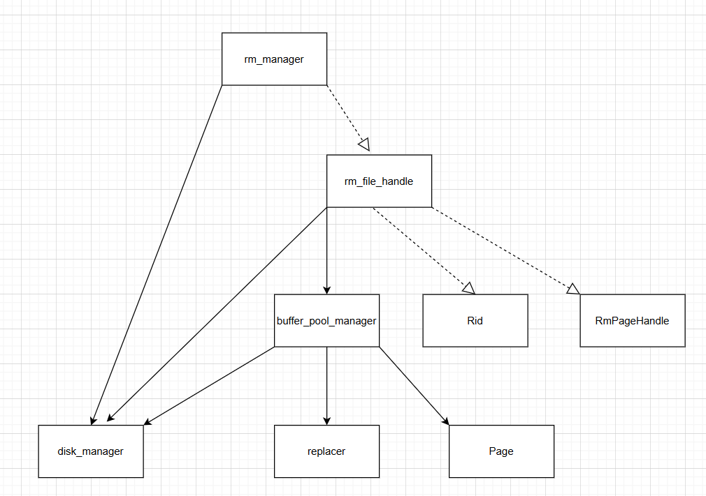

这个是存储管理最终所有模块之间的关联，大家可以根据这个结构慢慢的拆分出小块的知识点，然后进行深度学习和交流。

**接下来就是存储管理的设计：**

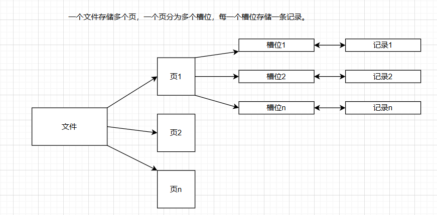

其中，一个文件包含多个页，一个页包含多个槽位，一个槽位存储一条记录。

根据这个设计图，**我们可以发现使用页设计带来的好处**。

加速查找，如果不存在页，我们就只能一条一条记录进行查找。这样以来我们就可以分块进行查找，数据越大越体现了优越性。

再这个基础上又可以拓展很多知识，**如何高效的利用页呢？**

首先引入的就是**页的替换策略**，淘汰页和非淘汰页。如果查找空闲页就直接去淘汰页里面去，对于不淘汰的页就不需要查找。这样也可以大大提高效率。**其次就是使用B+树进行页查找**，快速找到我们想要的页在哪里，比起一页一页进行查找效率高了很多。

紧接着我们来看一下具体的应用图：

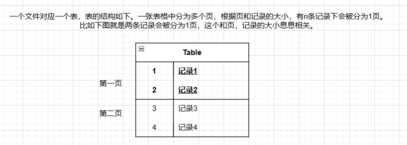

所有记录都是放置到一个表中，对于一张表其实就是一个文件，根据页和记录的大小，每一个页都会有着固定的记录数，比如上图当中一个页就存储了两条记录。这个就是表，页，记录之间的关系。

这样一看我们遍历所有的记录是不是就只需要从第一页开始，然后查找每一条记录是否存在，然后不断前往下一页就可以了。


最终就可以来看看具体的实现框架图了。

**整体实现框架图：**

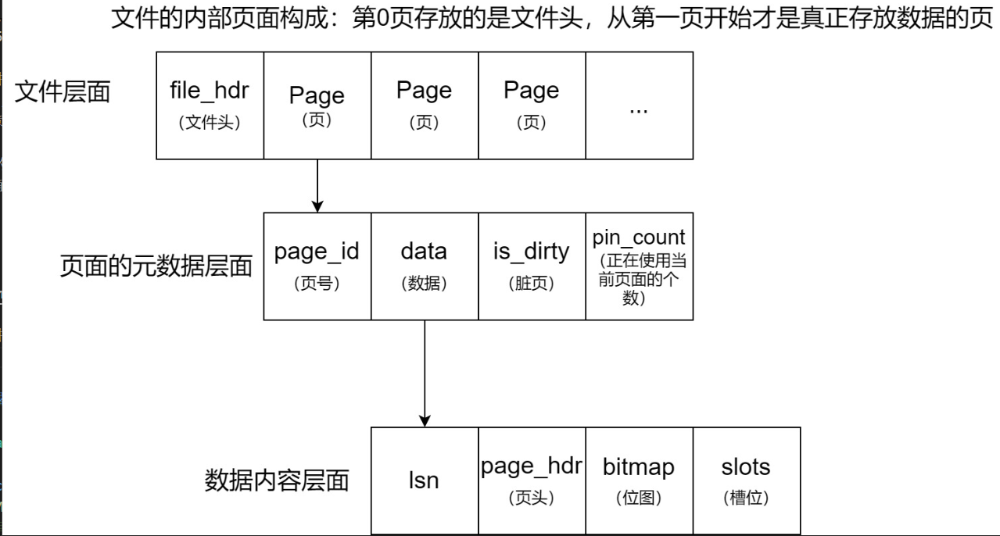

**文件和页之间的关系图：**


**页的具体结构：**


**页和槽位之间的关系图：**

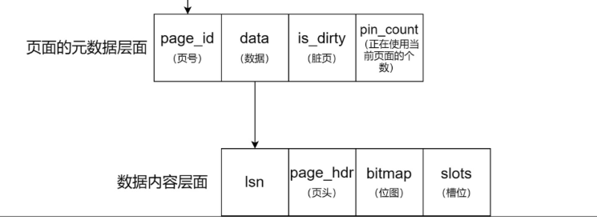

一个文件存在多个页，其中第0页存放的是文件头，存储着当前文件的元数据，比如存放了多少个页，一个页的记录数等。

从第一页开始，后面的每一个页都存放着多条记录，都是放入到页中的data里面去。

然后data的结构又分为4部分，第一部分为日志，第二部分为页头，存储页的元数据。第三部分为位图，用于标记当前位置中是否存在记录，第四部分是槽位，同于存放记录。

其中页头和日志部分的大小是确定的了，对于记录的个数n需要我们自己判断。页面大小已知，一个未知数n和一个方程（总大小小于等于页大小），可以求出页最多可以放置多少记录数。

这样一看存储管理部分的所有框架都已经分析清楚了，接下来就要看看是如何具体实现这一部分的知识的。

在实现存储管理之前，我们需要了解一下存储管理中常用的函数：

[传送门](https://blog.csdn.net/2301_81170690/article/details/149769815?sharetype=blogdetail&sharerId=149769815&sharerefer=PC&sharesource=2301_81170690&spm=1011.2480.3001.8118)


## 磁盘存储管理器（DiskManager类）
```c++
class DiskManager {
    public:
        explicit DiskManager(); // Constructor
        ~DiskManager() = default; // Destructor
        // 读写页面
        void write_page(int fd, page_id_t page_no, const char *offset, int num_bytes);
        void read_page(int fd, page_id_t page_no, char *offset, int num_bytes);
        // 对指定文件分配页面编号
        page_id_t allocate_page(int fd);
        // 文件操作
        bool is_file(const std::string &path);
        void create_file(const std::string &path);
        int open_file(const std::string &path);
        void close_file(int fd);
        void destroy_file(const std::string &path);
};
```

**整体框架**：
通过文件句柄找到文件磁盘路径，或者通过文件磁盘路径找到文件句柄。
`std::unordered_map<std::string, int> path2fd_; `
//<Page文件磁盘路径,Page fd>哈希表

`std::unordered_map<int, std::string> fd2path_;`
 //<Page fd,Page文件磁盘路径>哈希表

表示当前文件中以及分配的页面个数。
`std::atomic<page_id_t> fd2pageno_[MAX_FD]{};`
 // 文件中已经分配的页面个数，初始值为0

**具体关系如下：**

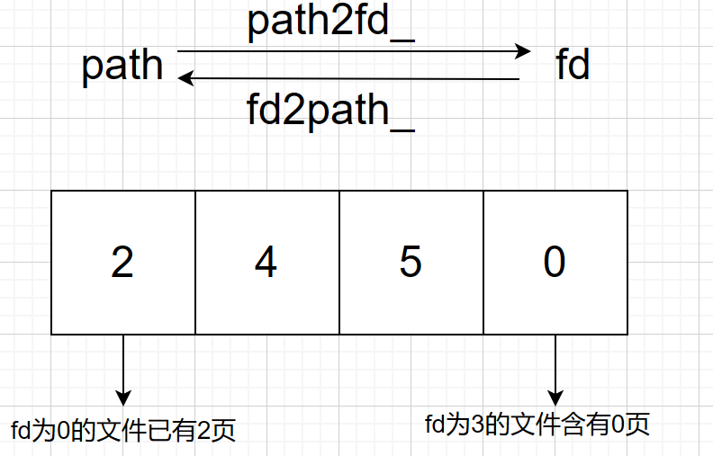

**（1）读写页面**
`void write_page(int fd, page_id_t page_no, const char *offset, int num_bytes);`
`void read_page(int fd, page_id_t page_no, char *offset, int num_bytes);`
将数据写入磁盘里面，或者从磁盘中读出数据。

第一个参数fd表示文件句柄（File Handle）， 是一个用于标识和管理打开文件的抽象引用或标识符。它的核心作用是简化程序对文件的操作，充当程序与操作系统之间的 “中介”，避免直接暴露底层文件的物理信息（如磁盘地址、存储结构等）。

第二个参数page_no表示页号， 是用于唯一标识一个 “页”（Page）的整数编号，相当于页在物理存储或逻辑空间中的 “地址”。它是定位、管理和访问页的核心标识，贯穿数据存储、读写、索引等整个流程。

第三个参数offset表示数据，需要写入磁盘或者读出的数据。

第四个参数num_bytes，表示每一页的数据大小。

实现：首先先用lseek函数定位到目标页的起始位置，然后再调用系统给出的函数wirte或者read写入或者读出。

**（2）分配页面编号**
`page_id_t allocate_page(int fd);`
目前采取简单的自增分配策略：指定文件的页面编号加1。
实现：fd2pageno[fd]++。

**（3）文件操作**
`bool is_file(const std::string &path);`
参数：path指的是文件的路径
用于判断指定路径文件是否存在。
实现：调用stat函数。

`void create_file(const std::string &path);`
用于创建指定路径文件。
实现：调用open函数，使用O_CREAT模式。

`void open_file(const std::string &path);`
用于打开指定路径文件。
实现：调用open()函数，使用O_RDWR模式。注意不能重复打开相同文件，并且需要更新文件打开列表。

`void close_file(int fd);`
用于关闭指定路径文件。
实现：调用close()函数。注意不能关闭未打开的文件，并且需要更新文件打开列表。

`void destroy_file(const std::string &path);`
用于删除指定路径文件。
实现：调用unlink()函数。注意不能删除未关闭的文件。

## 缓冲池替换策略（Replacer类）
```c++
class Replacer {
    public:
        explicit Replacer(size_t num_pages);
        ~Replacer();
        bool victim(frame_id_t *frame_id);
        void pin(frame_id_t frame_id);
        void unpin(frame_id_t frame_id);
};
```
负责跟踪缓冲池中每个页面所在帧的使用情况。当缓冲池没有空闲页面时，需要使用该类提供的替换策略选择一个页面进行淘汰。要求实现的替换策略为最近最少使用（LRU）算法。
**整体框架**：
`std::list<frame_id_t> LRUlist_;`
按加入的时间顺序存放unpinned pages的frame id，头部表示最近被访问

`std::unordered_map<frame_id_t,std::list<frame_id_t>::iterator> LRUhash_;`
通过frame_id_t找到其在双向链表中的迭代器位置。

`size_t max_size_;`
// 最大容量（与缓冲池的容量相同）

**具体关系如下**：

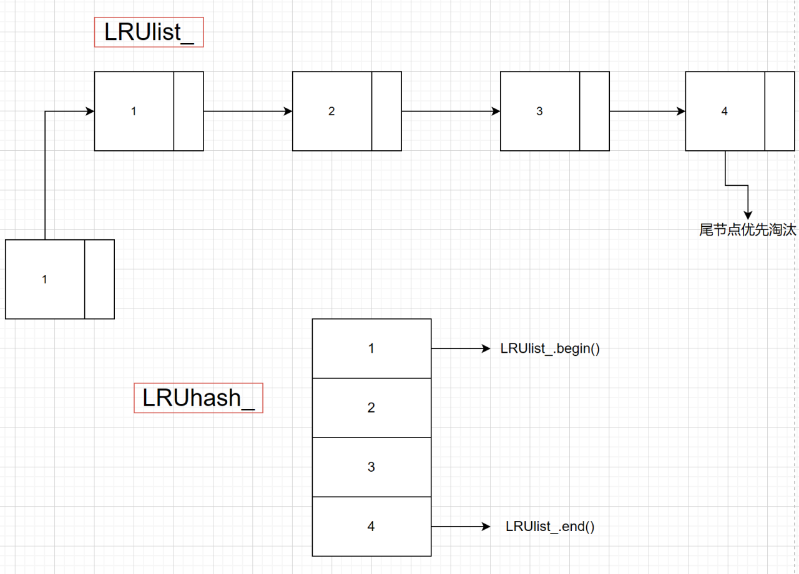

**(1) 初始化**
`Replacer(size_t num_pages);`
构造函数，初始化LRUlist的最大容量max_size。

**（2）替换操作**
`bool victim(frame_id_t *frame_id);`
当缓冲池要淘汰一个页面所在的帧，调用此函数。
实现：需要删除LRUlist中最远被unpin的帧（尾部），并传出该帧的编号给frame_id。

`void pin(frame_id_t frame_id);`
实现：当缓冲池要固定一个页面所在的帧，调用此函数，防止当前页面被淘汰。
需要删除LRUlist中指定的帧，若该帧不存在则无任何操作。

`void unpin(frame_id_t frame_id);`
当缓冲池要取消固定一个页面所在的帧（该页面的pin_count变为0），调用此函数，表示当前页面此时可以被替换。
实现：需要将指定帧插入到LRUlist中最近被unpin的位置（头部）。

## 缓冲池管理器（BufferPoolManager类）
```c++
class BufferPoolManager {
    public:
        BufferPoolManager(size_t pool_size, DiskManager *disk_manager);
        ~BufferPoolManager();
        Page *new_page(PageId *page_id);
        Page *fetch_page(PageId page_id);
        bool unpin_page(PageId page_id, bool is_dirty);
        bool delete_page(PageId page_id);
        bool flush_page(PageId page_id);
        void flush_all_pages(int fd);
        private:
        // 辅助函数
        bool find_victim_page(frame_id_t *frame_id);
        void update_page(Page *page, PageId new_page_id, frame_id_t new_frame_id);
};

```
**前提知识点-脏页**
脏页是指在内存中被修改过，但还没有被同步回磁盘的页面。如果缓冲池中的页的数据被修改了，我们是应该将其写入磁盘更新数据，但是如果当前页我们并没有用到或者说这一页的数据我们没有修改，此时我们是不需要写入磁盘的，可以适当减少对磁盘的IO操作。

**整体框架：**
`Page *pages_;`
buffer_pool中的Page对象数组，在构造空间中申请内存空间，在析构函数中释放，大小为BUFFER_POOL_SIZE
这个数组作为磁盘与缓冲池的 “关联中枢” ，核心作用是将磁盘上的逻辑页（通过 PageId 标识）与缓冲池中的物理内存页（通过 frame_id 索引）联系起来。

`std::unordered_map<PageId, frame_id_t, PageIdHash> page_table_;`
帧号和页面号的映射哈希表，用于根据页面的PageId定位该页面的帧编号。通过在缓冲池中维护page_id和frame_id的映射关系，实现了从数据页逻辑标识（page_id）到内存存储位置（frame_id）的快速转换。

`std::list<frame_id_t> free_list_;`
// 空闲帧编号的链表

**具体关系如下：**

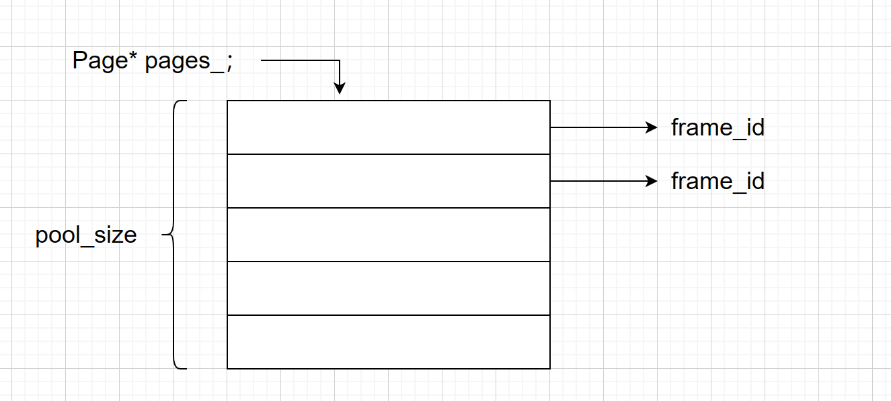

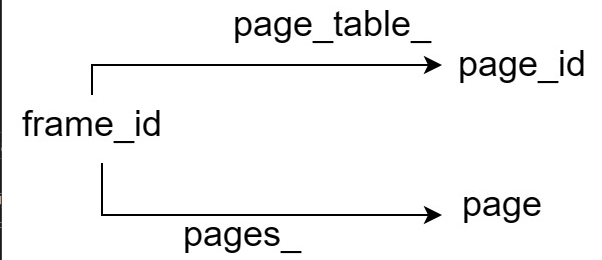

当数据页从磁盘加载到缓冲池时，会被放置到某个帧中，一个帧在某一时刻只能存储一个数据页，即一个frame_id对应一个page。我们可以通过Page*pages_这个数组，以frame_id为下标，获取存放在当前帧位置的页(pages_[frame_id])。

**（1）辅助函数**
`bool find_victim_page(frame_id_t *frame_id);`
用于寻找淘汰页。
实现：从缓冲池中查找可用的帧，如果此时缓冲池没有填满（即free_list_不为空），我们优先填满缓冲池。否则就需要采用LRU策略替换一个帧（调用replacer类）。

`void update_page(Page *page, PageId new_page_id, frame_id_t new_frame_id);`
用于更新页表和页面。
实现：更新页面数据, 如果为脏页则需写入磁盘，再更新为新页面，更新page元数据(data, is_dirty, page_id)和page table

**（2）主要函数**
`BufferPoolManager(size_t pool_size, DiskManager *disk_manager);`
构造函数，需要初始化缓冲池的最大容量pool_size，以及分配replacer和pages的地址空间。初始时free_list中帧编号的范围为[0,pool_size)。

`Page *new_page(PageId *page_id);`
用于在内存申请创建一个新的页面。
实现：包括更新页表和页面、固定页面、寻找淘汰页等。
此外，需要用DiskManager分配页面编号，并传出这个新页面的编号。

`Page *fetch_page(PageId page_id);`
用于获取缓冲池中的指定页面。
实现：包括更新页表和页面、固定页面、寻找淘汰页等。
此外，如果缓冲池中不存在该页面，需要用DiskManager从磁盘中读取。

`bool unpin_page(PageId page_id, bool is_dirty);`
用于使用完页面后，对该页面取消固定。
实现：先减少页面的一次引用次数，由于页面可能同时被多个线程使用，调用一次unpin_page()只会减少一次引用次数，只有当引用次数减少到0时，才能调用Replacer::unpin()来取消固定页面所在的帧。
参数is_dirty决定是否对页面置脏，如果上层修改了页面，就将该页面的脏标志置true。

`bool delete_page(PageId page_id);`
用于删除指定页面。
实现：包括更新页表和页面、更新空闲帧列表等。
注意：只有引用次数为0的页面才能被删除。

`bool flush_page(PageId page_id);`
用于强制刷新（写入）缓冲池中的指定页面到磁盘。
此处的"强制"指的是无论该页的引用次数是否大于0，无论该页是否为脏页，都将其刷新到磁
盘。

`void flush_all_pages(int fd);`
用于将指定文件中的存在于缓冲池的所有页面都刷新到磁盘。

***注意，在上述所有函数的实现中，淘汰脏页之前，都要将脏页写入磁盘。***

## 记录管理器
- 记录标识（Rid） 
```c++
struct Rid { 
    page_id_t page_no; //记录所在的页面编号（对应磁盘页的 PageId） 
    slot_id_t slot_no; //记录在页面内的槽位编号（对应 slots 数组的索引） 
};
```

page_no：关联到磁盘上的物理页面，通过 PageId 中的 page_no ），表示记录所在的“大容器”（页面存储
的基本单位）
slot_no:关联到页面内的具体位置（slots数组的索引），表示记录在 “大容器” 中的 “小格子”（槽位是页面
内记录的存储单元）。

### 记录操作（RMFileHandle类）

```c++
class RmFileHandle {
    public:
        RmFileHandle(DiskManager *disk_manager, BufferPoolManager *buffer_pool_manager, int fd);
        // 不考虑事务的记录操作（事务将在后续实验使用）
        std::unique_ptr<RmRecord> get_record(const Rid &rid, Context *context) const;
        Rid insert_record(char *buf, Context *context);
        void delete_record(const Rid &rid, Context *context);
        void update_record(const Rid &rid, char *buf, Context *context);
        // 辅助函数
        RmPageHandle create_new_page_handle();
        RmPageHandle fetch_page_handle(int page_no) const;
        RmPageHandle create_page_handle();
        void release_page_handle(RmPageHandle &page_handle);
};
```

数据库表中的一行数据，称为元组（Tuple）或者记录（Record），每条记录由多个字段组成。记录本质上就是一个字节序列，DBMS存储系统负责将其解释成属性类型和值。记录虽然是存放在磁盘而不是内存中，但是对记录的操作仍需在内存中进行，所以在组织记录时需要考虑如何让它在内存能够被高效访问。

根据字段的长度是否固定，可以分为定长字段和变长字段。
根据记录是否存在变长字段，可以分为定长记录和变长记录。
定长记录全部由定长字段组成，是比较简单的记录组织形式，只需要存储实际数据和固定的字段长度。
本实验采用定长记录的组织形式，便于计算某个定长字段在记录中的偏移位置。

**整体框架：**
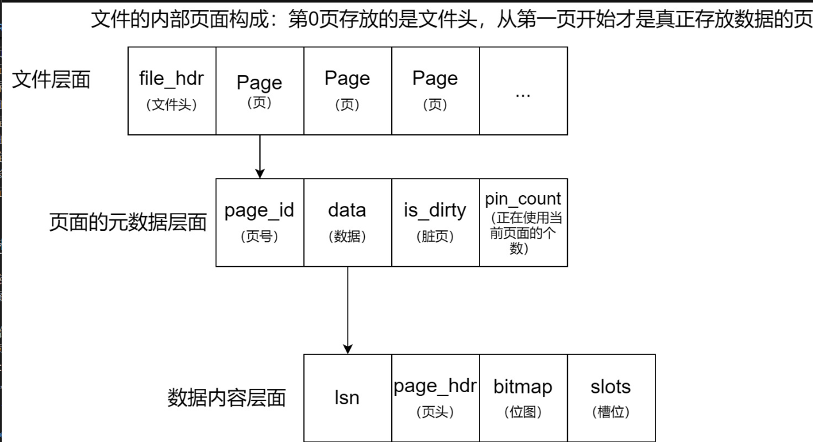

一个文件存放这多个页，每个页存放多个数据。
其中文件的结构图如上图所示，其中第一部分就是文件头，后面的每一个部分就是存放的页。
文件头是文件开始的地方，用于记录每一个文件和page的信息。
每一个页面包含页号、数据、脏页标记和使用个数。
而每一个页的data结构分为4个板块：第一部分是lsn（这部分为0），第二部分为页头page_hdr，记录页的信息，第三部分为位图bitmap，用来标记是否存在槽位，第四部分为slots，表示槽位，是用来存在记录的地方。

**(1) 辅助函数**
`RmPageHandle create_new_page_handle();`
用于创建一个新的RmPageHandle。
实现：用缓冲池创建新页，并更新page_hdr和file_hdr中的各项内容。
提示：调用BufferPoolManager::new_page()创建新页面。

`RmPageHandle fetch_page_handle(int page_no) const;`
用于获取指定页面对应的RmPageHandle。
实现：使用缓冲池获取指定页面，并生成page_handle返回给上层
提示：调用BufferPoolManager::fetch_page()获取指定页面。

`RmPageHandle create_page_handle();`
用于创建或获取一个空闲的RmPageHandle。
实现：先判断第一个空闲页是否存在，如果存在就直接用fetch_page_handle()获取它；否则直接用create_new_page_handle()创建一个新的RmPageHandle。

`void release_page_handle(RmPageHandle &page_handle);`
当page handle中的page从已满变成未满的时候调用此函数。
实现：当一个页面从没有空闲空间的状态变为有空闲空间状态时，更新文件头和页头中空闲页面相关的元数据
提示：更新page_hdr的下一个空闲页和file_hdr的第一个空闲页

**(2) 主要函数**
`RmFileHandle(DiskManager *disk_manager, BufferPoolManager *buffer_pool_manager, int fd);`
构造函数，当上层创建一个指向RmFileHandle的指针时将会在此初始化。需要从磁盘中读出文件头的信息，即初始化file_hdr。还需要设置该文件中开始分配的页面编号。

`std::unique_ptr<RmRecord> get_record(const Rid &rid, Context *context) const;`
用于获取一条指定记录。由Rid得到record。
实现：把位于指定slot的record拷贝一份，然后返回给上层。

`Rid insert_record(char *buf, Context *context);`
用于插入一条指定记录。
实现：对于堆文件组织形式，只需要找到一个有足够空间存放该记录的页面。当所有已分配页面中都没
有空间时，就申请一个新页面来存放该记录。
注意更新bitmap，它跟踪了每个slot是否存放了record；此外，如果当前page handle中的page
插入后已满，还需要更新file_hdr的第一个空闲页。

`void delete_record(const Rid &rid, Context *context);`
用于删除一条指定记录。使用rid中的page_no和slot_no。
实现：先获取page handle，然后将page的bitmap中表示对应槽位的bit置0。
注意如果删除操作导致该页面恰好从已满变为未满，那么需要调用release_page_handle()。

`void update_record(const Rid &rid, char *buf, Context *context);`
用于更新一条指定记录。
实现：先获取page handle，然后直接更新page即可。

### 记录迭代器（RmScan类）
```c++
class RecScan {
    public:
        virtual ~RecScan() = default;
        virtual void next() = 0;
        virtual bool is_end() const = 0;
        virtual Rid rid() const = 0;
};

class RmScan : public RecScan {
    public:
        RmScan(const RmFileHandle *file_handle);
        void next() override;
        bool is_end() const override;
        Rid rid() const override;
};

```
通过 RMScan 类实现对表中所有记录的迭代访问，无需用户手动定位页面和槽位：
基于页面的bitmap，自动跳过空闲槽位，只返回有效记录。
支持从第一条记录到最后一条记录的顺序遍历，为查询（如全表扫描）提供基础支持

一个页面会存储多条记录，扫描的逻辑：从存储的第一个页开始，到缓冲池可以存储的最多页数，对每一个页的所有记录进行扫描。

**具体关系图如下：**

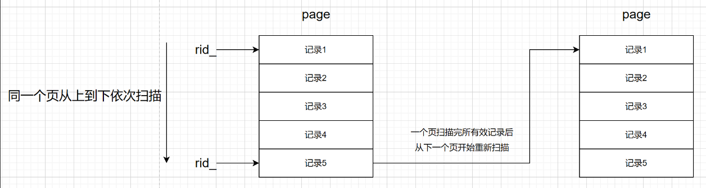

**主要函数**

`RmScan(const RmFileHandle *file_handle);`
传入file_handle，初始化rid。
RmScan内部存放了rid，用于指向一个记录。

`void next() override;`
用于找到文件中下一个存放了记录的位置。
实现：对于当前页面，可以用bitmap来找bit为1的slot_no。如果当前页面的所有slot都没有存放record，就找下一个页面。

`bool is_end() const override;`
判断是否到达文件末尾，即最后一个页面的最后一个slot。
可以自主定义末尾的标识符，如RM_NO_PAGE。

`Rid rid() const override;`
获取当前记录所在的位置信息（rid）


# 项目提交

我们需要使用git向gitlab上面传递项目，我们就需要学习一下git的知识

**git语句分析**

```
1. git config --global user.name "Your Name" 
作用：设置 Git 的全局用户名。`

2. git config --global user.email "email@example.com" 作用：设置 Git 的全局用户邮箱。

3. git init 
作用：在当前目录下创建一个新的 Git 仓库。

4. git add . 
作用：将当前目录下的所有文件（包括子目录）添加到 Git 的暂存区（Staging Area）。

5. git commit -m "Initial commit" 
作用：将暂存区中的更改保存为一次提交（commit），并附上一条提交信息。

6. git status 
作用：查看当前仓库状态。

7. git status -s 
作用：查看简洁格式的状态信息。

8. git diff readme.txt 
作用：readme.txt 的未暂存更改。

9. git diff --staged readme.txt 
作用：readme.txt 的已暂存更改。

10. git diff HEAD readme.txt 
作用：readme.txt 的所有本地更改。

11. git log 
作用：查看当前分支的提交历史记录（commit history）。

12. git reflog 
作用：记录本地仓库中 HEAD 的每一次移动记录，包括提交、切换分支、重置等操作。
HEAD 作用：HEAD 是一个指向当前所在提交或分支的“指针”。

13. git reset --hard commit_id 
作用：将当前分支的 HEAD、暂存区和工作目录都重置为指定的提交状态。

14. git config --global credential.helper store 
作用：配置 Git 记住你的用户名和密码，（通常是 GitHub、GitLab 等平台的账号密码），
避免每次推送或拉取时都要手动输入。

15. git checkout -- <file>
作用：丢弃某个文件在工作目录中的修改，恢复为最近一次提交的状态。

16. git reset HEAD <file> 
作用：取消暂存某个文件，即将它从暂存区移回工作目录，但保留文件内容不变。

17. git rm <file> 
作用：从 Git 仓库中删除一个文件，包括从工作目录和暂存区中同时删除。

18. git remote add origin git@github.com:michaelliao/learngit.git
作用：将一个远程仓库地址添加到本地 Git 项目中，并命名为 origin。

19. git push origin master
作用：将本地的 master 分支（主分支）内容推送到名为 origin 的远程仓库。

20. git remote -v
作用：查看当前配置的所有远程仓库地址，包括读写权限地址。

21. git remote rm origin
作用：从本地 Git 配置中删除名为 origin 的远程仓库。

22. git branch作用：列出当前所有的本地分支，并标记当前所在分支。

23. git branch <name>
作用：创建一个名为 <name> 的新分支（但不会自动切换过去）。

24. git checkout <name>
作用：切换到已存在的分支 <name>。

25. git switch <name>
作用：切换到已存在的分支 <name>（是 checkout 的更安全替代命令）。

26. git checkout -b <name>
作用：创建并切换到一个名为 <name> 的新分支（常用命令）。

27. git switch -c <name>
作用：创建并切换到一个名为 <name> 的新分支（推荐用于清晰操作意图）。

28. git merge <name>
作用：将指定分支 <name> 的更改合并到当前所在的分支中。

29. git branch -d <name>
作用：删除名为 <name> 的分支（如果该分支已合并到其他分支）。

30. git log --graph
作用：以图形化方式显示提交历史，展示分支和合并的结构。

31. git merge feature1
作用：将名为 feature1 的分支合并到当前所在分支中。

```

**具体项目提交流程：**

```

1. git config --global user.name "Your Name" 
作用：设置 Git 的全局用户名。

2. git config --global user.email "email@example.com" 作用：设置 Git 的全局用户邮箱。

3. git config --global credential.helper store 
作用：配置 Git 记住你的用户名和密码（通常是 GitHub、GitLab 等平台的账号密码），
避免每次推送或拉取时都要手动输入。

4. git init 
作用：在当前目录下创建一个新的 Git 仓库。

5. git add . 
作用：将当前目录下的所有文件（包括子目录）添加到 Git 的暂存区（Staging Area）。

6. git commit -m "Initial commit" 
作用：将暂存区中的更改保存为一次提交（commit），并附上一条提交信息。

7. git status 
作用：查看当前仓库状态。

8. git remote -v
作用：查看当前配置的所有远程仓库地址，包括读写权限地址。

9. git remote add origin git@github.com:michaelliao/learngit.git
作用：将一个远程仓库地址添加到本地 Git 项目中，并命名为 origin。

10. git remote -v
作用：查看当前配置的所有远程仓库地址，包括读写权限地址。

11. git push origin master
作用：将本地的 master 分支（主分支）内容推送到名为 origin 的远程仓库。

```