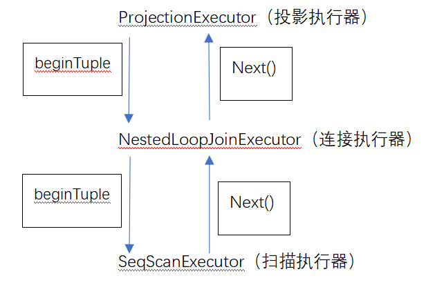

首先来介绍一下算子树。

在数据库管理系统中，**算子树（Operator Tree）** 是一种用于表示查询执行计划的数据结构。每个节点代表一个操作符（operator），这些操作符负责执行具体的数据库操作，如表扫描、投影、连接等。算子树是实现查询处理的核心概念之一，在数据库执行SQL查询时，优化器会生成一个最优的执行计划，并以算子树的形式组织起来。

我们算子树的构建和执行的方式采用的是火山模型。

**火山模型**（Volcano Model），也称为迭代器模型（Iterator Model），是构建和执行这种算子树的一种方式。在这个模型下，每个操作符都被视为一个迭代器，它们遵循相同的接口进行数据处理。上级需要的接口从最底下的一层，不断的通过筛选和处理，传递给上面一层，最终可以得到自己想要的数据。



这里我们用6种接口来进行数据处理。

```

void beginTuple()

功能：找到当前第一个合法的记录位。

```

```

void nextTuple()

功能：找到下一个合法的记录位。

```

```

bool is_end()

功能：判断执行是否结束。

```

```

std::unique_ptr<RmRecord> Next()

功能：实现当前执行器的功能。

```

```

size_t tupleLen()

功能：求出当前记录的长度。

```

```

const std::vector<ColMeta>& cols()

功能：求出此时包含的列的元数据，可以获取对应列的信息。

```

**1. `SeqScanExecutor`**

扫描算子：用于遍历所有记录并进行初步筛选，返回满足where条件的合法记录。

`void beginTuple()`

找到第一个合法记录的位置。

从第一个记录开始，判断当前记录是否满足where条件（eval_conds），如果满足说明已经找到了第一个记录，结束查找。否则就不断前往下一个继续查找。

`void nextTuple()`

找到下一个合法记录的位置。

由于当前合法位置已经被使用了，需要先前往下一个记录位，判断当前记录位是否合法，如果合法就结束，否则就继续前面下一个记录位。

`bool is_end()`

判断执行是否结束。

如果此时不存在可以选择的记录了，说明扫描执行结束。

`std::unique_ptr<RmRecord> Next()`

实现当前执行器的功能。

通过文件句柄获取当前位置的合法记录。

`size_t tupleLen()`

返回当前记录的长度。

一条记录存在多个字段，求出所有字段的长度相加就是当前记录的长度（可以通过最后一个字段的偏移量+最后一个字段的长度得到所有字段的长度）。

`const std::vector<ColMeta>& cols()`

获取扫描的列的元数据。

**2. `NestedLoopJoinExecutor`**

`void beginTuple()`

找到第一个合法记录的位置。

当前执行器存在左右孩子，并且连接类型默认为内连接。所以枚举两个表的所有组合情况，形成一个新的记录，再判断是否符合where条件。如果成立就结束，否则就继续匹配。

`void nextTuple()`

找到下一个合法记录的位置。

由于当前位置已经是合法记录位，前往下一个记录位并进行判断是否为合法记录，如果是就结束，否则就继续匹配。

`bool is_end()`

判断执行是否结束。

如果不存在记录位说明执行结束。

`std::unique_ptr<RmRecord> Next()`

实现当前执行器的功能。

将左边和右边的记录合并，并返回这条新记录。

`size_t tupleLen()`

返回当前记录的长度。

此时新的记录长度就是左边记录的长度+右边记录的长度。


**3. `GroupExecutor`**

`void beginTuple()`

找到第一个合法记录的位置。


`void nextTuple()`

找到下一个合法记录的位置。


`bool is_end()`

判断执行是否结束。


`std::unique_ptr<RmRecord> Next()`

实现当前执行器的功能。


`size_t tupleLen()`

返回当前记录的长度。


**4. `AggregateExecutor`**

`void beginTuple()`

找到第一个合法记录的位置。


`void nextTuple()`

找到下一个合法记录的位置。


`bool is_end()`

判断执行是否结束。


`std::unique_ptr<RmRecord> Next()`

实现当前执行器的功能。


`size_t tupleLen()`

返回当前记录的长度。


**5. `SortExecutor`**

`void beginTuple()`

找到第一个合法记录的位置。


`void nextTuple()`

找到下一个合法记录的位置。


`bool is_end()`

判断执行是否结束。


`std::unique_ptr<RmRecord> Next()`

实现当前执行器的功能。


`size_t tupleLen()`

返回当前记录的长度。


**6. `ProjectionExecutor`**

`void beginTuple()`

找到第一个合法记录的位置。

调用子执行器的 `beginTuple()`来获取第一个合法记录的位置。

`void nextTuple()`

找到下一个合法记录的位置。

调用子执行器的 `nextTuple()`来获取下一个合法记录的位置。

`bool is_end()`

判断执行是否结束。

如果子节点不存在说明执行结束。

`std::unique_ptr<RmRecord> Next()`

实现当前执行器的功能。

创建一个长度为 len_ 的新记录，然后从prev_rec中取出需要的字段，按新的偏移复制到输出记录中。若子执行器为聚合操作，则直接复制所有列。最后返回构造好的新记录。

7. `UpdateExecutor`

`std::unique_ptr<RmRecord> Next()`

实现当前执行器的功能。

遍历所有需要更新记录的位置，检查每一个位置的记录类型是否合法，若不合法报错， 否则更新该条记录数据，并调用update_record()更新文件上的记录。

8. `InsertExecutor`

`std::unique_ptr<RmRecord> Next()`

实现当前执行器的功能。

创建一条新记录，枚举插入的值values，全部复制给新记录，最后将这条新记录插入到表的数据文件中。

9. `DeleteExecutor`

`std::unique_ptr<RmRecord> Next()`

实现当前执行器的功能。

枚举需要删除记录的位置，通过数据文件句柄调用delete_record()删除该位置的记录。
