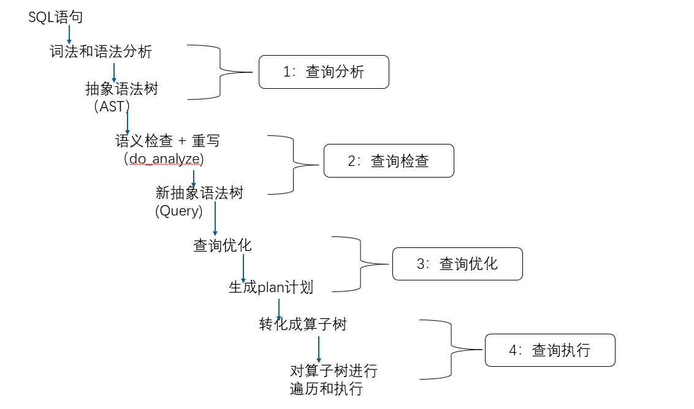
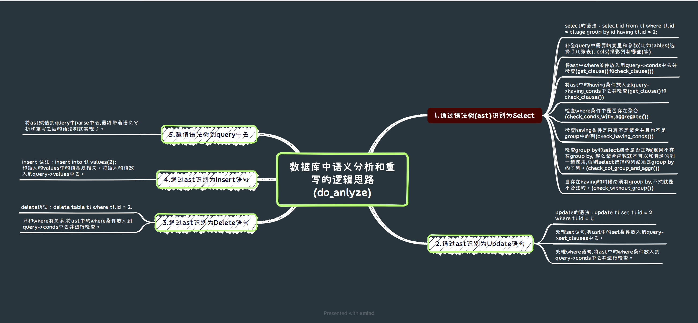
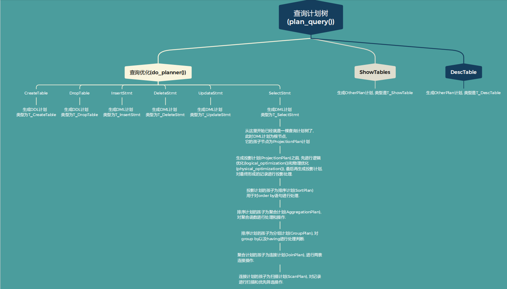
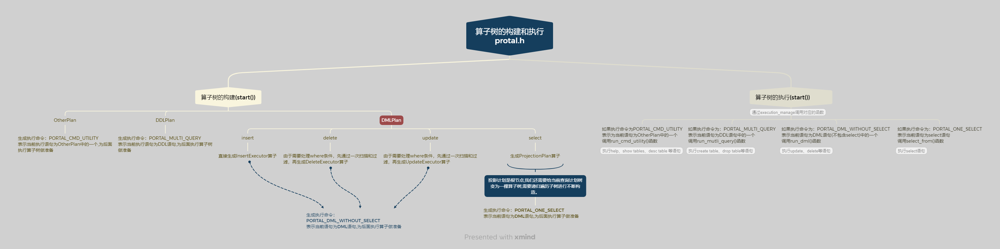
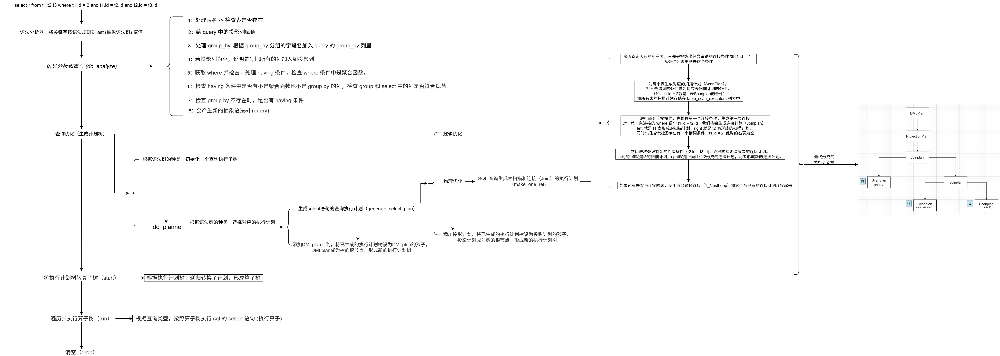
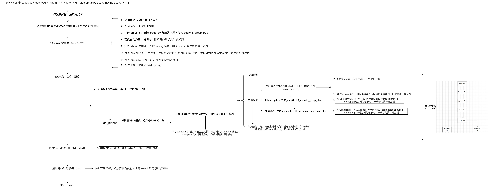
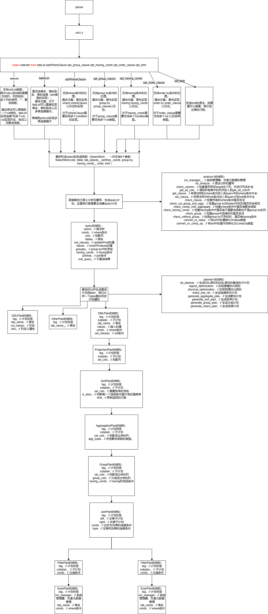

# 查询处理

## 查询处理概述:

### 元数据管理的层级结构

数据库名称和数据库中创建的表：

```cpp
class DbMeta {
private:
    std::string name_;     // 数据库名称
    std::map<std::string, TabMeta> tabs_;  // 数据库内的表名称和元数据的映射
};
```

表的元数据和字段的元数据分别用`TabMeta` 和`ColMeta`来表示：

```c++
struct TabMeta {
    std::string name;    // 表的名称
    std::vector<ColMeta> cols;  // 表的字段
};

struct ColMeta {
    std::string tab_name;  // 字段所属表名称
    std::string name;      // 字段名称
    ColType type;          // 字段类型
    int len;               // 字段长度
    int offset;            // 字段位于记录中的偏移量
    bool index;            // 该字段上是否建立索引
};
```

## sql语句整体流程图:



### 第一部分 查询分析

#### 目的：

用户输入的 SQL （比如 `SELECT * FROM user` ），词法分析先拆分识别每个 “单词”（认出 `SELECT` 是查询命令、`user` 是表名 ），再把这些单词按 SQL 语法规则，对AST对应的构造函数进行赋值（语法分析→AST）。简单来说就是在实现函数接口。

#### 做法：
1. **词法分析（lex.l）**
将输入的 SQL 字符串拆分为最小的语法单元（Token），并过滤无关字符（如空格、注释），为后续语法分析提供“原料”。以下是其关键功能和实现：

    （1）. 配置选项（%option）  
    设置词法分析器的基础行为：  
    - `caseless`：关键字大小写不敏感（如 `Select`、`SELECT` 均识别为 `SELECT`）。  
    - `noyywrap`/`nounput`/`noinput`：禁用不必要的默认函数，简化实现。  
    - `bison-bridge`/`bison-locations`：支持与 Bison 语法分析器交互，传递 Token 位置信息（行号、列号）。  


    （2）. 模式定义（正则表达式）  
    通过正则表达式定义各类 Token 的格式：  
    - **基础元素**：  
    - `alpha`/`digit`：匹配字母和数字，用于构建标识符。  
    - `white_space`/`new_line`：匹配空格、制表符、换行符（后续会被忽略）。  
    - `sign`：匹配正负号（用于数值）。  
    - **标识符**：`{identifier}` 定义表名、列名等（规则：字母开头，可包含字母、数字、下划线，如 `user_name`、`t1`）。  
    - **数值与字符串**：  
    - `value_int`：整数（如 `123`、`-45`）。  
    - `value_float`：浮点数（如 `3.14`、`-0.5`）。  
    - `value_string`：字符串（单引号包裹，如 `'abc'`）。  
    - **运算符**：  
    - `single_op`：单字符运算符（如 `;`、`(`、`+`）。  
    - 多字符运算符（如 `>=`、`<=`、`<>`、`!=`）。


    （3）.规则匹配与处理  
    遍历输入字符流，按优先级匹配上述模式，并执行对应动作：  
    - **忽略无关内容**：空格、换行、注释（单行 `--...` 或多行 `/*...*/`）直接跳过。  
    - **关键字识别**：如 `SELECT`、`WHERE`、`GROUP` 等，直接返回对应的 Token（如 `SELECT` 对应 `SELECT` 常量）。  
    - **字面量处理**：  
    - 整数/浮点数：转换为对应数值类型，存入 `yylval`（供语法分析器使用）。  
    - 字符串：去除首尾单引号，存入 `yylval->sv_str`。  
    - **位置跟踪**：通过 `YY_USER_ACTION` 记录每个 Token 的行号和列号（如 `yylloc->last_line`），用于错误提示（如“第 5 行语法错误”）。  
    - **错误处理**：遇到未定义的字符（如 `#`），输出“意外字符”错误。


2. **语法分析（Yacc/Bison 部分）**
语法分析基于词法分析生成的 Token 序列，根据 SQL 语法规则构建抽象语法树（AST），明确语句的结构和语义。以下是其核心功能和实现：

    (1).  配置与类型定义
    - **模式声明**：  
    - `%define api.pure full`：生成可重入（线程安全）的解析器。  
    - `%locations`：启用位置跟踪，用于错误定位。  
    - `%define parse.error verbose`：生成详细的语法错误信息（如“缺少 `FROM` 关键字”）。  
    - **Token 与类型关联**：  
    - 通过 `%token` 声明词法分析器返回的 Token（如 `SELECT`、`VALUE_INT`），并指定其存储类型（如 `VALUE_INT` 对应 `sv_int`）。  
    - 通过 `%type` 声明非终结符（语法单元）的类型（如 `stmt` 对应 `sv_node`，表示一个 SQL 语句节点）。


    (2). 语法规则定义
    按 SQL 语句的结构，定义分层的语法规则（从完整语句到子句）：  
    - **顶层规则**：`start` 表示完整输入，匹配一个语句加 `;`，或 `HELP`/`EXIT` 等特殊命令。  
    - **语句分类**：`stmt` 涵盖所有 SQL 语句类型：  
    - `dbStmt`：数据库操作（如 `SHOW TABLES`）。  
    - `ddl`：数据定义语言（如 `CREATE TABLE`、`DROP INDEX`）。  
    - `dml`：数据操纵语言（如 `INSERT`、`SELECT`、`UPDATE`）。  
    - `txnStmt`：事务控制（如 `BEGIN`、`COMMIT`）。  
    - **子句细化**：  
    - **查询语句（`SELECT`）**：规则包含 `selector`（查询列）、`tableList`（表）、`whereClause`（条件）、`group_clause`（分组）等子句，最终构建 `SelectStmt` 节点。  
    - **插入语句（`INSERT`）**：匹配 `INSERT INTO 表 VALUES (值列表)`，构建 `InsertStmt` 节点。  
    - **条件与表达式**：`condition` 规则定义 `WHERE` 或 `HAVING` 中的条件（如 `col = value`、`col IN (子查询)`），通过 `BinaryExpr` 节点表示二元运算。  
    - **聚合与排序**：支持 `GROUP BY`、`ORDER BY`、`LIMIT` 等，分别构建 `GroupBy`、`OrderBy` 节点。


    (3). AST构建
    每个语法规则的右侧通过 `$$ = ...` 生成对应的 AST 节点：  
    - 例如，`SELECT selector FROM tableList` 规则中，`$$ = std::make_shared<SelectStmt>($2, $4)` 表示用查询列（`$2`）和表（`$4`）构建 `SelectStmt` 节点。  
    - 子句嵌套：如 `whereClause` 由多个 `condition` 通过 `AND` 连接，最终生成条件列表存入 AST。


    (4). 错误处理
    - 定义 `yyerror` 函数：结合位置信息（`locp`）输出错误（如“第 3 行第 10 列：缺少 `)`”）。  
    - 规则优先级：通过 Token 出现顺序和规则结构避免歧义（如 `AND` 的优先级高于条件表达式）。


### 第二部分 查询检查



#### 目的：

analyze部分会检查：用户输入的表 / 列是否存在（比如 `user` 表真有吗？`age` 列是不是属于user表？ ）、还有`GROUP BY`不存在时不能用`HAVING`，`WHERE`条件中不能用聚合函数等，保证 SQL 符合语法规范，然后把 AST 中松散的信息转化为结构化的`Query`对象，方便后续查询优化和执行。

#### 做法
1. **核心函数**
- `do_analyze（）`
作用：do_analyze 是 SQL 查询分析器的核心方法，负责将抽象语法树（AST）转换为可执行的查询对象（Query），并进行语法和语义验证。

2. **辅助函数**
- `check_column（）`
作用：验证查询中引用的列是否合法，并自动补全未指定的表名（解决如 SELECT id FROM t1, t2 中列所属表的歧义问题）。

- `get_all_cols()`
作用:从指定的表列表中收集所有列的元数据（如列名、表名、类型等），为后续列验证提供基础数据。

- `get_clause()`
作用:将 AST 中的条件表达式（如 WHERE、HAVING、JOIN ON）转换为查询对象可识别的 Condition 结构，并处理条件中的值、子查询和列引用。

- `set_clause()`
作用:将 AST 中的 SET 子句（如 UPDATE t SET a = 1, b = b + 2）转换为查询对象可识别的 SetClause 结构。

- `check_clause()`
作用：验证条件子句中涉及的列存在性、类型兼容性，以及子查询结果的合法性。

- `check_col_group_and_aggr()`
作用:检查 SELECT 投影列与 GROUP BY 子句的逻辑是否一致

- `check_conds_with_aggregate()`
作用:检查是否在 WHERE 条件中使用聚合函数（聚合函数应在 HAVING 中使用）

- `check_having_conds()`
作用:检查HAVING 条件中使用的非聚合列是否出现在 GROUP BY 子句中不存在的的列。

- `check_group()`
作用:验证 GROUP BY 子句中引用的列是否真实存在于查询涉及的表中。

- `check_without_group()`
作用:检查是否在无 GROUP BY 子句时使用 HAVING 条件（HAVING 必须与 GROUP BY 配合使用）

- `convert_sv_value()`
作用:将 AST 中的值节点（IntLit、FloatLit、StringLit）转换为查询执行引擎可识别的 Value 类型。

- `convert_sv_comp_op()`
作用:将 AST 中的比较操作符（如 SV_OP_EQ、SV_OP_LT）转换为查询执行引擎可识别的 CompOp 类型。


### 第三部分 查询优化

#### 目的：

planner部分会根据语义分析后的`Query`对象，通过选择索引（如用索引扫描替代全表扫描）、确定表连接方式（如嵌套循环或排序合并连接）等优化逻辑，让查询更高效。再把这些优化后的逻辑转化为具体的执行步骤（比如单表的扫描计划、多表的连接计划、聚合 / 排序计划等），最终生成可被执行引擎直接调用的`Plan`对象，实现查询性能的最大化。

#### 做法



### 第四部分 查询执行

#### 目的：

portal部分：分为start、run和drop三个阶段，start阶段负责相关资源初始化，并把查询执行计划转换成对应的算子树，run阶段通过各个算子的Next()接口，遍历算子树并执行算子生成执行结果，drop阶段需要释放start阶段申请的资源。



#### 做法

**1. 元信息处理(SmManager)**
作用：主要用于管理数据库的元数据和文件操作
下面是SmManager类的函数定义：

```c++
class SmManager {
   public:
    DbMeta db_;             // 当前打开的数据库的元数据
    std::unordered_map<std::string, std::unique_ptr<RmFileHandle>> fhs_;    
    // file name -> record file handle, 当前数据库中每张表的数据文件
    std::unordered_map<std::string, std::unique_ptr<IxIndexHandle>> ihs_;   
    // file name -> index file handle, 当前数据库中每个索引的文件
   private:
    DiskManager* disk_manager_;
    BufferPoolManager* buffer_pool_manager_;
    RmManager* rm_manager_;
    IxManager* ix_manager_;

   public:
    SmManager(DiskManager* disk_manager, BufferPoolManager*
    buffer_pool_manager, RmManager* rm_manager, IxManager* ix_manager)
        : disk_manager_(disk_manager),
          buffer_pool_manager_(buffer_pool_manager),
          rm_manager_(rm_manager),
          ix_manager_(ix_manager) {}

    ~SmManager() {}

    BufferPoolManager* get_bpm() { return buffer_pool_manager_; }

    RmManager* get_rm_manager() { return rm_manager_; }  

    IxManager* get_ix_manager() { return ix_manager_; }  

    bool is_dir(const std::string& db_name);

    void create_db(const std::string& db_name);

    void drop_db(const std::string& db_name);

    void open_db(const std::string& db_name);

    void close_db();

    void flush_meta();

    void show_tables(Context* context);

    void desc_table(const std::string& tab_name, Context* context);

    void create_table(const std::string& tab_name, 
    const std::vector<ColDef>& col_defs, Context* context);

    void drop_table(const std::string& tab_name, Context* context);

    void create_index(const std::string& tab_name, 
    const std::vector<std::string>& col_names, Context* context);

    void drop_index(const std::string& tab_name, 
    const std::vector<std::string>& col_names, Context* context);
    
    void drop_index(const std::string& tab_name, 
    const std::vector<ColMeta>& col_names, Context* context);
};
```

**这里我们不考虑索引，直接对元数据进行分析操作。**

**整体框架：**

`DbMeta db_` 当前的数据库，可以访问数据库中元数据。

`std::unordered_map<std::string, std::unique_ptr<RmFileHandle>> fhs_;`

通过fhs_可以得到当前文件名的文件句柄，对当前文件进行操作。同时也可以知道此时数据库中哪些文件已经被打开了。

**实现函数：**

我们需要去实现当前类中某些函数的功能：
再实现这些函数之前我们需要了解一下一些系统自带的函数：

[传送门](https://blog.csdn.net/2301_81170690/article/details/149769815?sharetype=blogdetail&sharerId=149769815&sharerefer=PC&sharesource=2301_81170690&spm=1011.2480.3001.8118)

在SmManager类中，你需要实现的函数接口如下：

`open_db(const std::string& db_name)`：系统通过调用该接口打开数据库
在运行系统时，你需要在命令行中输入一个参数`<database name>`，代表当前数据库的名称，系统会创建一个同名文件夹，并在文件夹中存储所有数据库相关的数据文件。系统再次启动时，会打开数据库名称的同名文件夹，并通过读取元数据文件获取当前数据库的相关元数据。 同时，系统还需要打开所有的表文件和索引文件，并将文件句柄加载到系统中。

**提示：** 可以去参考官方给我们写好了create_db函数，大部分已经写的很清楚了。
可以用`chdir`系统函数进行当前数据库，调用`std::ifstream ofs(DB_META_NAME)`打开数据库存储信息的文件并从中写出数据。

`close_db()`：系统通过调用该接口关闭数据库
在系统服务端关闭时，系统调用该函数，将元数据信息、表数据等落盘，并关闭相关文件。

**提示：** 先将数据库的信息全部写会磁盘，通过fhs_关闭已经存在的文件，清空所有元数据，再调用chdir()退出当前数据库。

`drop_table(const std::string& db_name)`：删除表
系统调用该函数删除指定名称等表，并删除相关的数据文件，更新元数据信息

**提示：** 通过fhs_关闭当前表的文件，并从数据库中的所有表中删除当前表，再将信息刷入磁盘中去。

**2. 算子树的遍历和执行**
   
首先来介绍一下算子树。

在数据库管理系统中，**算子树（Operator Tree）** 是一种用于表示查询执行计划的数据结构。每个节点代表一个操作符（operator），这些操作符负责执行具体的数据库操作，如表扫描、投影、连接等。算子树是实现查询处理的核心概念之一，在数据库执行SQL查询时，优化器会生成一个最优的执行计划，并以算子树的形式组织起来。

我们算子树的构建和执行的方式采用的是火山模型。

**火山模型**（Volcano Model），也称为迭代器模型（Iterator Model），是构建和执行这种算子树的一种方式。在这个模型下，每个操作符都被视为一个迭代器，它们遵循相同的接口进行数据处理。上级需要的接口从最底下的一层，不断的通过筛选和处理，传递给上面一层，最终可以得到自己想要的数据。


这里我们用6种接口来进行数据处理。

```

void beginTuple()

功能：找到当前第一个合法的记录位。

```

```

void nextTuple()

功能：找到下一个合法的记录位。

```

```

bool is_end()

功能：判断执行是否结束。

```

```

std::unique_ptr<RmRecord> Next()

功能：实现当前执行器的功能。

```

```

size_t tupleLen()

功能：求出当前记录的长度。

```

```

const std::vector<ColMeta>& cols()

功能：求出此时包含的列的元数据，可以获取对应列的信息。

```

**1. `SeqScanExecutor`**

扫描算子：用于遍历所有记录并进行初步筛选，返回满足where条件的合法记录。

`void beginTuple()`

找到第一个合法记录的位置。

从第一个记录开始，判断当前记录是否满足where条件（eval_conds），如果满足说明已经找到了第一个记录，结束查找。否则就不断前往下一个继续查找。

`void nextTuple()`

找到下一个合法记录的位置。

由于当前合法位置已经被使用了，需要先前往下一个记录位，判断当前记录位是否合法，如果合法就结束，否则就继续前面下一个记录位。

`bool is_end()`

判断执行是否结束。

如果此时不存在可以选择的记录了，说明扫描执行结束。

`std::unique_ptr<RmRecord> Next()`

实现当前执行器的功能。

通过文件句柄获取当前位置的合法记录。

`size_t tupleLen()`

返回当前记录的长度。

一条记录存在多个字段，求出所有字段的长度相加就是当前记录的长度（可以通过最后一个字段的偏移量+最后一个字段的长度得到所有字段的长度）。

`const std::vector<ColMeta>& cols()`

获取扫描的列的元数据。

**2. `NestedLoopJoinExecutor`**

`void beginTuple()`

找到第一个合法记录的位置。

当前执行器存在左右孩子，并且连接类型默认为内连接。所以枚举两个表的所有组合情况，形成一个新的记录，再判断是否符合where条件。如果成立就结束，否则就继续匹配。

`void nextTuple()`

找到下一个合法记录的位置。

由于当前位置已经是合法记录位，前往下一个记录位并进行判断是否为合法记录，如果是就结束，否则就继续匹配。

`bool is_end()`

判断执行是否结束。

如果不存在记录位说明执行结束。

`std::unique_ptr<RmRecord> Next()`

实现当前执行器的功能。

将左边和右边的记录合并，并返回这条新记录。

`size_t tupleLen()`

返回当前记录的长度。

此时新的记录长度就是左边记录的长度+右边记录的长度。


**3. `GroupExecutor`** (待完善)

`void beginTuple()`

找到第一个合法记录的位置。


`void nextTuple()`

找到下一个合法记录的位置。


`bool is_end()`

判断执行是否结束。


`std::unique_ptr<RmRecord> Next()`

实现当前执行器的功能。


`size_t tupleLen()`

返回当前记录的长度。


**4. `AggregateExecutor`** (待完善)

`void beginTuple()`

找到第一个合法记录的位置。


`void nextTuple()`

找到下一个合法记录的位置。


`bool is_end()`

判断执行是否结束。


`std::unique_ptr<RmRecord> Next()`

实现当前执行器的功能。


`size_t tupleLen()`

返回当前记录的长度。


**5. `SortExecutor`** (待完善)

`void beginTuple()`

找到第一个合法记录的位置。


`void nextTuple()`

找到下一个合法记录的位置。


`bool is_end()`

判断执行是否结束。


`std::unique_ptr<RmRecord> Next()`

实现当前执行器的功能。


`size_t tupleLen()`

返回当前记录的长度。


**6. `ProjectionExecutor`**

`void beginTuple()`

找到第一个合法记录的位置。

调用子执行器的 `beginTuple()`来获取第一个合法记录的位置。

`void nextTuple()`

找到下一个合法记录的位置。

调用子执行器的 `nextTuple()`来获取下一个合法记录的位置。

`bool is_end()`

判断执行是否结束。

如果子节点不存在说明执行结束。

`std::unique_ptr<RmRecord> Next()`

实现当前执行器的功能。

创建一个长度为 len_ 的新记录，然后从prev_rec中取出需要的字段，按新的偏移复制到输出记录中。若子执行器为聚合操作，则直接复制所有列。最后返回构造好的新记录。


**7. `UpdateExecutor`**

`std::unique_ptr<RmRecord> Next()`

实现当前执行器的功能。

遍历所有需要更新记录的位置，检查每一个位置的记录类型是否合法，若不合法报错， 否则更新该条记录数据，并调用update_record()更新文件上的记录。


**8. `InsertExecutor`**

`std::unique_ptr<RmRecord> Next()`

实现当前执行器的功能。

创建一条新记录，枚举插入的值values，全部复制给新记录，最后将这条新记录插入到表的数据文件中。


**9. `DeleteExecutor`**

`std::unique_ptr<RmRecord> Next()`

实现当前执行器的功能。

枚举需要删除记录的位置，通过数据文件句柄调用delete_record()删除该位置的记录。

## sql语句样例流程图

1. `select * from t1 , t2, t3 where t1.id = 2 and t1.id = t2.id and t2.id = t3.id;`
   


2. `select t4.age,count(*) from t3,t4 where t3.id = t4.id group by t4.age having t4.age >= 18;`




## 目前数据库框架：

再总结完上面的知识点之后，我形成了自己的一套数据库的框架逻辑：



后面的时间会根据这个框架图和之前的思路图进行分析和设计